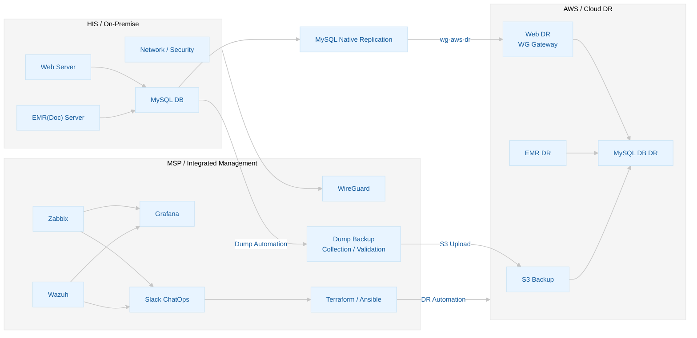

# 병원 인프라 보안·HA 시스템 및 클라우드 DR 통합 관제 시스템

 

## ✦ 프로젝트 개요

>의료 환경의 IT 인프라는 환자 진료와 핵심 업무의 연속성에 직접적인 영향을 미치므로, **장애 발생 시 서비스 중단을 최소화하고 신속한 복구 체계를 확보하는 것이 중요하다.**
>
>본 프로젝트는 병원 인프라의 **고가용성(HA)과 재해복구(DR)를 통합하여 서비스 연속성을 확보**하는 것을 목표로 한다.  
> **(RTO ≤ 5m / RPO ≤ 5m / RPO(Dump) ≤ 30m)**
>
>온프레미스 환경에서는 **네트워크·게이트웨이·방화벽 이중화를 통한 HA**를 구성하고, MSP에서는 **인프라·보안 통합 관제와 DR 운영을 중앙 관리**한다.
>
>온프레미스에서 복구가 어려운 장애 발생 시에는 MSP 서버의 **Terraform과 Ansible 기반 IaC 자동화를 통해 AWS DR 환경으로 Failover**하고, 서비스 정상화 이후 Failback을 수행하는 **Hybrid Cloud 기반 HA/DR 시스템 구축**이 본 프로젝트의 핵심이다.

 

### 하이브리드 클라우드 전체 서비스 구조

 
 
 
 

# HIS (On-Premise)

>온프레미스는 병원 내부의 **Primary HIS 서비스 및 네트워크 환경**으로, 실제 Cisco 네트워크 장비와 GNS3 기반 내부 HIS 환경을 연동하여 구성한다.
>
>외부 공개 Web 영역은 실제 Cisco 네트워크의 **VLAN 20·100과 HSRP 기반 Gateway HA**를 적용하고, 내부 PC·EMR·DB 영역은 GNS3에서 **VLAN 10·30으로 논리적으로 분리**하여 독립적인 내부 네트워크를 구성한다.
>
>또한 GNS3 내부 Gateway/Core 이중화와 pfSense CARP 기반 방화벽 이중화를 적용하고, 실제 네트워크에서도 L3 Core 및 Gateway 이중화를 구성하여 **단일 장비 장애에 대한 서비스 연속성(BCP)과 고가용성(HA)** 을 확보한다.

 
 

## [HIS] 🛠︎ 기술 스택

| 운영 환경 분류 | 기술명 | 기술 활용 |
| :--- | :--- | :--- |
| **OS** | Ubuntu 22.04 | Web·EMR·DB 서버 및 EMR 환경 운영 |
| **Firewall** | pfSense | 방화벽, IDS/IPS 및 CARP 기반 이중화 구성 |

 

| 핵심 기술 분류 | 기술명 | 기술 활용 |
| :--- | :--- | :--- |
| **Network Simulation** | GNS3 | 내부 HIS 네트워크 및 HA 토폴로지 구성 |
| **DNS / WAF** | Cloudflare | DNS, SSL/TLS 및 외부 Web WAF 적용 |

 

| 개발 / 검증 도구 | 활용 |
| :--- | :--- |
| **Tera Term** | Cisco 장비 Console/SSH 접속 및 CLI 설정 |
| **Wireshark** | 패킷 캡처 및 네트워크 트래픽 분석 |

 

| 피지컬 네트워크 분류 | 장비명 | 기술 활용 |
| :--- | :--- | :--- |
| **Router** | Cisco 2800 Series | 외부 `172` 대역 연결 및 동적 라우팅 |
| **L2 Switch** | Catalyst 2950 Series | Access 및 물리 네트워크 연결 |
| **L3 Switch-1** | Catalyst 3560 Series | 메인 네트워크 Core 및 Gateway HA |
| **L3 Switch-2** | Catalyst 3550 Series | 대기 네트워크 Core 및 Gateway HA |

 
 

## [HIS] 🌐︎ 피지컬 네트워크

| Equipment | Interface / VLAN | IP Address | Role |
| :--- | :--- | :--- | :--- |
| **Router** | Fa0/0 | `172.16.100.254/16` | 외부 `172` 대역 연결 |
| **Router** | Fa0/1 | `192.168.100.1/24` | L3 Core Uplink |
| **L2-SW** | Access / Uplink | `192.168.100.250/24` | Web 및 GNS3 Host 물리 연결 |
| **L3-SW1** | VLAN 100 | `192.168.100.2/24` | Router Uplink |
| **L3-SW2** | VLAN 100 | `192.168.100.3/24` | Router Uplink |

 

| VLAN | Network | L3-SW1 | L3-SW2 | VIP | Purpose |
| :--- | :--- | :--- | :--- | :--- | :--- |
| **VLAN 20** | `192.168.20.0/24` | `192.168.20.2` | `192.168.20.3` | `192.168.20.1` | Web Server |
| **VLAN 100** | `192.168.100.0/24` | `192.168.100.2` | `192.168.100.3` | - | Router / Core Uplink |

 
 

## [HIS] 🌐︎ GNS3 네트워크

| VLAN | Network | GNS3 L3-1 | GNS3 L3-2 | VIP | Purpose |
| :--- | :--- | :--- | :--- | :--- | :--- |
| **VLAN 10** | `192.168.10.0/24` | `192.168.10.2` | `192.168.10.3` | `192.168.10.1` | Internal Client / PC |
| **VLAN 30** | `192.168.30.0/24` | `192.168.30.2` | `192.168.30.3` | `192.168.30.1` | EMR / EMR / DB |

 

| GNS3 Node | VLAN | IP Address | Gateway | Role |
| :--- | :--- | :--- | :--- | :--- |
| **PC** | VLAN 10 | `DHCP (192.168.10.0/24)` | `192.168.10.1` | 내부 사용자 / EMR 접근 Client |
| **DB** | VLAN 30 | `192.168.30.10/24` | `192.168.30.1` | MySQL Database |
| **EMR** | VLAN 30 | `192.168.30.11/24` | `192.168.30.1` | EMR / 문서 서비스 |

 
 

## [HIS] 🌐︎ 서비스 네트워크

| Service | Domain Name & URL | IP Address | Network | Access |
| :--- | :--- | :--- | :--- | :--- |
| **Web** | `hospital-web.pp.ua` | `192.168.20.10` | Physical VLAN 20 | External |
| **EMR** | `hospital-web.pp.ua/emr` | `192.168.30.11` | GNS3 VLAN 30 | Internal / Controlled |
| **DB** | - | `192.168.30.10` | GNS3 VLAN 30 | Web / EMR → DB only |

 
 

## [HIS] 📡︎ 프로토콜

| 프로토콜 | 적용 장비 (Physical) | 적용 목적 |
| :--- | :--- | :--- |
| **RSTP** | Catalyst 2950·3550·3560 | 실제 스위치 구간 루프 방지 및 장애 경로 복구 |
| **HSRP** | Catalyst 3550·3560 | VLAN 20 Gateway 및 L3 Core 이중화 |
| **RIPv2** | Cisco 2800 / Catalyst 3550·3560 | Router ↔ L3 Core 간 동적 라우팅 및 경로 정보 교환 |

 

| 프로토콜 / 기술 | 적용 영역 (GNS3) | 적용 목적 |
| :--- | :--- | :--- |
| **OSPF** | GNS3 L3 Network | GNS3 내부 동적 라우팅 및 경로 교환 |
| **Gateway VIP** | VLAN 10 / VLAN 30 | PC·EMR·DB 내부 Gateway 이중화 |
| **CARP** | pfSense | 방화벽 VIP 공유 및 Master/Backup 이중화 |

 
 

## [HIS] 🔒︎ 보안

| 네트워크 경계 보안 | 적용 계층 | 적용 위치 | 적용 대상 / 구간 | 역할 |
| :--- | :--- | :--- | :--- | :--- |
| **pfSense** | **L3 ~ L4** | Firewall | 외부 ↔ 내부 네트워크 | 네트워크 접근 제어 및 트래픽 필터링 |
| **DMZ** |	- | pfSense / 네트워크 구성	| 외부 공개 Web 서비스 | 외부 공개 서비스와 내부 업무망 분리 |
| **IDS/IPS** | **L3 ~ L7** | pfSense | 외부 ↔ 내부 트래픽 | 악성 및 비정상 네트워크 트래픽 탐지·차단 |
| **VLAN (Physical)** | **L2** | Cisco L2/L3 Switch | VLAN 20 / 100 | Web 및 Uplink 네트워크 분리 |
| **VLAN (GNS3)** | **L2** | GNS3 L2/L3 Network | VLAN 10 / 30 | PC와 EMR/DB 내부망 분리 |
| **ACL** | **L3 ~ L4** | Cisco L3 Switch / Router | VLAN 간 통신 및 관리 접근 | 허용된 네트워크·서비스만 접근하도록 제어 |

 

| 웹 / 애플리케이션 보안 | 적용 계층 | 적용 위치 | 적용 대상 / 구간 | 역할 |
| :--- | :--- | :--- | :--- | :--- |
| **WAF (Cloudflare)** | **L7** | Cloudflare | 외부 구간 ↔ Web 서비스 | 외부 구간에서 SQLi·XSS 등 웹 공격을 관리형 규칙으로 탐지·차단 |
| **WAF (Application)** | **L7** | Web Server (Node.js Express) | Web 애플리케이션 내부 | 웹 요청(URL·Body·Query)의 웹 공격(SQLi·XSS) 탐지 시 403 차단 |
| **SSL/TLS** | **L5 ~ L6** | Cloudflare | 외부 Web 서비스 | HTTPS 암호화 및 클라이언트와의 통신 보호 |
| **HTTPS** | **L7** | Nginx / Cloudflare | Web 서비스 | 클라이언트 ↔ 웹 서버 간 통신 암호화 |

 

| 시스템 관리 보안 | 계층 | 적용 위치 | 적용 대상 / 구간 | 역할 |
| :--- | :--- | :--- | :--- | :--- |
| **SSH** | **L7** | Cisco 장비 / Ubuntu | Router, L3/L2 Switch, 서버 | Telnet 대신 암호화된 원격 관리 |

 
 
 
 

# MSP

>MSP는 병원 On-Premise와 분리된 **외부 통합 관제 및 DR 운영 환경**으로, Zabbix·Grafana 기반 인프라 모니터링과 Wazuh 기반 보안 관제를 수행한다.
>
>**WireGuard VPN을 통해 On-Premise와 MSP 간 관제·관리 통신을 보호**하고, 장애 발생 시 Slack ChatOps 기반 승인 절차를 통해 DR 전환을 관리한다.
>
>**Terraform과 Ansible을 활용하여 AWS DR 인프라 구축 및 서버 복구를 자동화**하고, Failover·Failback과 FinOps를 통합 관리한다.
>
>MySQL Native Replication 및 암호화 Dump 상태를 관제하여 **RTO/RPO 지표를 수집·관리**하고 DR 운영 상태를 확인한다.

 
 

## [MSP] 🛠︎ 기술 스택

| 운영 환경 분류 | 기술명 | 기술 활용 |
| :--- | :--- | :--- |
| **OS** | Ubuntu 22.04 | MSP 통합 관제 및 DR 관리 서버 운영 |
| **Firewall** | pfSense | MSP LAN 격리 및 WireGuard 네트워크 구성 |

 

| 통합 관제 분류 | 기술명 | 기술 활용 |
| :--- | :--- | :--- |
| **Monitoring** | Zabbix | 서버·네트워크 장애 및 DR 상태 모니터링 |
| **SIEM** | Wazuh | 보안 로그 수집·분석 및 이상 행위 탐지 |
| **Dashboard** | Grafana | 인프라·DR·보안 지표 통합 시각화 |

 

| 자동화 / 운영 분류 | 기술명 | 기술 활용 |
| :--- | :--- | :--- |
| **IaC** | Terraform | AWS DR 인프라 자동 구축 |
| **Configuration** | Ansible | DR 서버 구성 및 복구 자동화 |
| **Container** | Docker | DR 서비스 실행 환경 컨테이너화 |
| **VPN** | WireGuard | On-Premise ↔ MSP 관제·관리 통신 보호 |
| **ChatOps** | Slack | 장애 알림 및 Failover·Failback 2인 승인 |
| **CI/CD** | GitHub Actions | DR 이미지 빌드·보안 검사 및 ECR 배포 자동화 |

 
 

## [MSP] 🌐︎ 외부 관제 네트워크

| Equipment | Interface | CIDR / IP | Gateway | Role |
| :--- | :--- | :--- | :--- | :--- |
| **pfSense** | WAN | `172.16.100.21/16 (DHCP)` | DHCP | 외부망 연결 |
| **pfSense** | LAN | `10.10.10.1/24` | - | MSP Gateway / Firewall |
| **Ubuntu**  | eth0 | `10.10.10.10/24` | `10.10.10.1` | 통합 관제 및 AWS DR 관리 서버 |

 
 

## [MSP] 🌐︎ VPN 네트워크

| Component | Local Network | Target | Purpose |
| :--- | :--- | :--- | :--- |
| **WireGuard** | `192.168.200.0/24` | On-Prem ↔ MSP | 모니터링 및 관리 통신 |

 
 

## [MSP] 📡︎ 프로토콜

| 프로토콜 | 적용 구간 | 적용 목적 |
| :--- | :--- | :--- |
| **SNMP** | 네트워크 장비 ↔ Zabbix | 네트워크 장비의 상태 및 성능 데이터 수집·모니터링 |
| **WireGuard** | On-Premise ↔ MSP | VPN 터널을 통한 온프레미스와 MSP 간 관제·관리 통신 암호화 간 보안 통신 |

 
 

## [MSP] 🔍︎ 통합 모니터링

| 관제 영역 | 기술 | 관제 대상 | 주요 역할 |
| :--- | :--- | :--- | :--- |
| **Infrastructure** | Zabbix | On-Premise Web·EMR·DB | 장애 감지, 가용성 및 자원 상태 모니터링 |
| **Dashboard** | Grafana | Zabbix / DR 지표 | RTO/RPO 및 DR 운영 상태 시각화 |
| **Network** | SNMP | Router / L2·L3 Switch | 네트워크 장비 상태 및 성능 수집 |
| **DR** | Zabbix + Custom Script | MySQL CDC(NR) / DB Dump | 복제 상태, Failover/Failback 및 복구 상태 확인 |
| **ChatOps** | Slack | Zabbix / DR Automation | 장애 알림 및 DR 2인 승인 |
| **Automation** | Terraform + Ansible | AWS DR Infrastructure | DR 인프라 생성, 서버 구성 및 서비스 복구 |

 
 

## [MSP] 🔒︎ 통합 보안 관제

| 보안 영역 | 기술 | 적용 대상 | 역할 |
| :--- | :--- | :--- | :--- |
| **SIEM** | Wazuh | On-Premise 서버 /보안 이벤트 | 보안 로그 중앙 수집·분석 및 EDR/XDR 적용 |
| **VPN** | WireGuard | On-Premise ↔ MSP | 관제 및 관리 트래픽 암호화 |
| **Control** | Slack ChatOps | DR Failover / Failback | 관리자 2인 승인 기반 DR 실행 통제 |
| **Backup** | OpenSSL Encrypted Dump | MySQL Backup | DB 백업 파일 암호화 및 복구 데이터 보호 |

 
 

## [MSP] 📁︎ DB 백업 관리

| 구분 | 방식 | 역할 | 설명 |
| :--- | :--- | :--- | :--- |
| **시점 백업** | 암호화 Dump | 보조 복구 | On-Prem DB의 30분 주기 암호화 Dump를 수집·검증하고 AWS S3로 전송 |
| **백업 관제** | Zabbix / Custom Script | 백업 상태 확인 | Dump 생성·전송·무결성 및 S3 업로드 상태 모니터링 |

 
 

## [MSP] 🕫 ChatOps DR 승인 정책

| 구분 | 역할 |
| :--- | :--- |
| **ChatOps Alert** | 일반 인프라·보안 이벤트 알림 |
| **ChatOps Failover** | 일반 DR Failover 요청 및 관리자 2인 승인 |
| **ChatOps Failback** | On-Prem 정상화 후 Failback 요청 및 관리자 2인 승인 |
| **ChatOps Emergency** | 자동 감지/일반 요청 경로 사용이 어려운 경우 긴급 DR 요청 |

 
 

## [MSP] 📈︎ DR 운영 지표

| 항목 | 목표 / 기준 | 현재 상태 | 설명 |
| :--- | :--- | :--- | :--- |
| **RTO** | 30분 이내 | Live E2E 측정 | 장애 감지부터 AWS 서비스 복구까지 실제 Timestamp 기반 측정 |
| **RPO (NR)** | 데이터 손실 최소화 | Live NR 검증 | 정상 비동기 복제 상태에서 Binlog 기반 실시간 반영 |
| **RPO (Dump)** | 최대 30분 | 30분 주기 백업 | 마지막 정상 Dump 이후 변경 데이터는 손실 가능 |
| **RTO/RPO 증거** | 실제 로그 기반 | Evidence Collector 구현 | Zabbix·Slack·IaC·DB 이벤트의 Run ID / Incident ID 기준으로 산정 |
| **FinOps** | 비용 최적화 | Cold/Warm 혼합 | 평상시 AWS DR 서버를 중지하고 필요 시 기동 |

 
 
 
 

# CSP (Cloud / AWS)

>AWS DR은 **온프레미스 장애 발생 시 핵심 서비스를 신속하게 복구하기 위한 재해복구 환경**으로, Web·EMR·DB 서버를 구성한다.
>
>**Terraform·Ansible 기반 IaC 자동화**를 통해 장애 발생 시 DR 인프라를 신속하게 구성하고, **Cloudflare DNS 전환과 Failover/Failback 절차를 연계**하여 서비스 연속성을 확보한다.
>
>**VPC, IAM, Security Group**으로 네트워크와 접근 권한을 분리하고, 평상시 불필요한 EC2·NAT 자원을 비활성화하여 **DR 운영 비용을 최소화**한다.

 
 

## [CSP] 🛠︎ 서비스 / 리소스

| 인프라 분류 | AWS 서비스 | 기술 활용 |
| :--- | :--- | :--- |
| **Compute** | EC2 | Web / EMR(Doc) / DB DR 서버 운영 |
| **Storage** | EBS | DR EC2 시스템 디스크 |
| **Backup Storage** | S3 | MSP 암호화 DB Dump 저장 및 원격지 백업 |

 

| 네트워크 / 보안 분류 | AWS 서비스 / 리소스 | 기술 활용 |
| :--- | :--- | :--- |
| **Network** | VPC | AWS DR 전용 네트워크 `10.20.0.0/16` 구성 |
| **Subnet** | Public Subnet | Web DR 서버 배치 |
| **Subnet** | Private Subnet | EMR DR 및 DB DR 서버 배치 |
| **Routing** | Route Table | Public / Private Subnet 라우팅 제어 |
| **Internet** | Internet Gateway | Web DR 인터넷 통신 |
| **Outbound** | Web NAT Instance | Private EMR/DB 서버의 외부 통신 제공 |
| **DR VPN Gateway** | AWS Web + WireGuard | On-Prem DB와 AWS DR 간 Direct NR 전용 VPN Gateway |
| **Public IP** | Elastic IP | Web DR / WireGuard Endpoint |
| **Security** | Security Group | Web / EMR / DB 서비스별 접근 제어 |
| **Access Control** | IAM | AWS 리소스 및 자동화 접근 권한 관리 |

 

| 운영 / 자동화 분류 | AWS 서비스 | 기술 활용 |
| :--- | :--- | :--- |
| **Automation** | Lambda | EC2 Stop 및 DR 비용 최적화 자동화 |
| **Scheduling** | EventBridge | FinOps 자동화 작업 스케줄링 |
| **Logging** | CloudWatch Logs | Lambda 및 AWS 자동화 로그 저장 |
| **Container Registry** | ECR | DR Docker Image 저장 및 배포 |

 
 

## [CSP] 🌐︎ AWS 네트워크

| Component | Type | CIDR / IP | Role |
| :--- | :--- | :--- | :--- |
| **AWS VPC** | VPC | `10.20.0.0/16` | DR Network |
| **Public Subnet** | Subnet | `10.20.10.0/24` | Web DR |
| **Private Subnet** | Subnet | `10.20.20.0/24` | EMR DR |
| **Private Subnet** | Subnet | `10.20.30.0/24` | DB DR |

 

| DR Server | Subnet | Private IP | Public IP | Role |
| :--- | :--- | :--- | :--- | :--- |
| **Web DR** | Public | `10.20.10.10/24` | `52.79.244.146` | Web DR |
| **EMR DR** | Private | `10.20.20.10/24` | - | EMR Document DR |
| **DB DR** | Private | `10.20.30.10/24` | - | Database DR |

 

| Service | Primary | DR | DNS Failover |
| :--- | :--- | :--- | :--- |
| **Web** | On-Prem Web | AWS Web DR | `hospital-web.pp.ua` |
| **EMR** | On-Prem EMR | AWS EMR DR | `hospital-web.pp.ua/emr` |
| **DB** | On-Prem DB | AWS DB DR | - |

 

## [CSP] 🌐︎ VPN 네트워크

| Component | Local Network | Target | Purpose |
| :--- | :--- | :--- | :--- |
| **WireGuard** | `10.251.0.0/24` | On-Prem DB ↔ AWS DR | 실시간 데이터 전송 |

 
 

## [CSP] 📁︎ DB 복구 전략

| 구분 | 방식 | 역할 | 설명 |
| :--- | :--- | :--- | :--- |
| **실시간 복제** | MySQL Binlog CDC (Native Replication) | 메인 DR 복제 | On-Prem DB 변경사항을 AWS DB DR에 실시간 반영 |
| **시점 복구** | 암호화 Dump / S3 | 보조 복구 | 복제 데이터 오염 또는 장애 시 정상 시점의 백업으로 복구 |
| **하이브리드** | CDC(NR) + Dump | 최신성 + 안정성 | 실시간 복제와 시점 백업을 병행하여 DR 복구 방식 이원화 |
