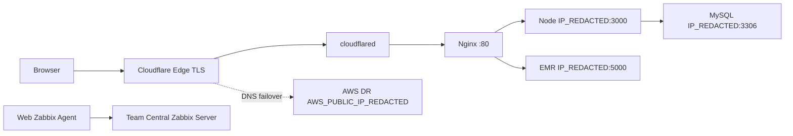

# Hospital HA / DR / Monitoring System

병원 Web 포털의 온프레미스 운영 상태를 읽어 수집한 GitHub 백업 준비 자료입니다. 담당 범위는 Ubuntu Web Server, Node/Express/EJS, Nginx, cloudflared, Zabbix Agent입니다. 운영 원본 `/home/vboxuser/hospital-web` 및 서버 설정은 변경하지 않았으며 GitHub push는 하지 않았습니다.

**상태: READY_FOR_MANUAL_INPUT (권한 제한 항목 포함).** 읽을 수 있는 Web 자료의 수집·검수와 수동 입력 자리를 준비했습니다. Netplan 원본과 권한 있는 nginx -T 전체 출력은 확보하지 못했으므로 완전 수집 또는 전체 복구 검증 완료를 뜻하지 않습니다.

현재 상태와 최종 설계는 구분합니다. **직접 확인**은 `web/inventory/` 및 복사 설정, **사용자 제공 최종 외부 컨텍스트**는 Cisco/Cloudflare/DR 설계, **미확인**은 [MISSING_ITEMS](docs/MISSING_ITEMS.md)입니다. [충돌 보고](docs/CONFLICT_REPORT.md)를 해결하지 않은 채 전체 설정을 일괄 복원하지 마세요.

Web은 `IP_REDACTED/24`, 최종 Gateway는 `IP_REDACTED`입니다. 수집 시 `enp0s8` NAT 기본 경로와 `wg0`가 보였으며 최종 네트워크 템플릿에 섞지 않았습니다.

| 디렉터리 | 내용 |
|---|---|
| web/app | 애플리케이션, EJS, 정적 파일, SQL, package/lock |
| web/configs | Nginx 활성 include 대상/비활성 설정, systemd, cloudflared, Zabbix; Netplan 접근 제한 안내 |
| web/scripts | 새 대상 전용 배포 준비, 읽기 전용 검사; 현재 서버에서는 실행 안 함 |
| web/inventory | OS/package/version/network/service 조회, 검증 결과 |
| web/docs | 소스 분석·환경변수·과거 자료 분리 |
| network | 물리/GNS3 입력 자리, VLAN·ACL·포트 정책 |
| cloudflare | DNS·Tunnel·Failover/Failback 최종 컨텍스트 |
| monitoring/zabbix-agent | Agent 연동 범위 및 외부 증빙 자리 |
| dr | AWS 배포 구조 템플릿; 실제 AWS 수집 아님 |
| docs | 구축·운영·복구·검증·보안·누락·충돌 보고 |

앱 entry는 `app.js`, 실행은 `npm start` → `node app.js`, 프로세스 관리는 systemd `hospital-web.service`입니다. 로그인/가입/로그아웃/환자 마이페이지/예약 등록·확인·취소·목록/정보 페이지가 구현되어 있습니다. `/health`와 `/check/db`는 DB 의존 검사입니다. 실제 구현 및 보안 한계는 [APPLICATION](web/docs/APPLICATION.md)에 기술했습니다.

네트워크 기술은 VLAN, 802.1Q Trunk, LACP EtherChannel, Rapid-PVST, Inter-VLAN Routing, HSRP, RIP v2, Static/Default Routing, TCP/UDP, Extended ACL입니다. Cisco 구성 원본은 아직 수집하지 않았습니다. [ACL 정책](network/ACL_POLICY.md)과 Web 설정은 별개 관리합니다.

`hospital-web.pp.ua`는 Cloudflare Tunnel CNAME을 사용하며 ingress는 Nginx `localhost:80`입니다. 공용 TLS는 Cloudflare Edge에서 종료됩니다. 장애 시 DNS를 AWS EIP A 레코드로 전환하는 설계입니다. Zabbix 범위는 **Web Server Zabbix Agent → Team Central Zabbix Server**까지이며 중앙 운영 설정은 포함하지 않습니다.

새 Ubuntu 재구축은 [WEB_SETUP](docs/WEB_SETUP.md), 복구는 [RECOVERY](docs/RECOVERY.md)를 따릅니다. DB 전체 스키마/덤프 및 Secret은 별도 확보해야 합니다. 로컬 로그인 페이지로 프로세스·프록시를 확인한 뒤 DB 의존 health, 외부 HTTPS, EMR을 단계별 확인합니다. [TEST_RESULTS](docs/TEST_RESULTS.md)에 이번 관측 결과를 기록했습니다.

실제 `.env`, 자격증명 JSON, 개인키, 로그, 의존성 디렉터리는 제외합니다. `.env.example`의 값은 배포 시 별도로 입력해야 합니다. [SECRET_SCAN](docs/SECRET_SCAN.md)은 이번 검사 범위와 잔여 항목을 설명합니다. 수동 자료 추가 후 반드시 다시 검사하며, 현재 단계에서는 `READY_FOR_GITHUB`를 선언하지 않습니다.
